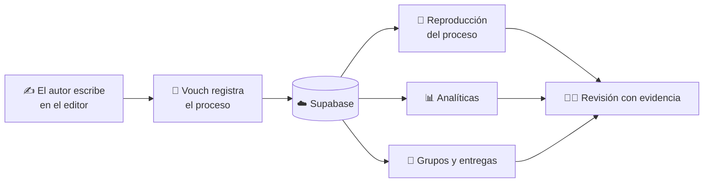

# ✍️ Vouch

**No solo qué escribiste: cómo lo escribiste.**
Una plataforma de escritura que registra, comprueba y muestra el proceso detrás de cada documento.

[🌐 Probar la demo](https://vouch-swart.vercel.app/) · [👤 Autor](https://github.com/Jona404p)

> 🔒 **Proyecto de código cerrado.** Este repositorio es solo una presentación del producto:
> no incluye el código fuente. Todos los derechos reservados.

---

## 📌 Índice

- [¿Qué es Vouch?](#-qué-es-vouch)
- [El problema](#-el-problema)
- [La solución](#-la-solución)
- [Funciones principales](#-funciones-principales)
- [Cómo funciona](#-cómo-funciona)
- [Para quién es](#-para-quién-es)
- [Tecnologías](#-tecnologías)
- [Privacidad y confianza](#-privacidad-y-confianza)
- [Estado y roadmap](#-estado-y-roadmap)
- [Licencia y contacto](#-licencia-y-contacto)

---

## 🎯 ¿Qué es Vouch?

Vouch es una app de escritura que **registra el proceso de creación de un documento** y lo
convierte en evidencia verificable. Mientras escribes, Vouch guarda cómo evoluciona el trabajo
(sesiones, ediciones, tiempos, pegados) y después permite **reproducir ese proceso** y consultarlo
en un panel de analíticas.

Así, un documento deja de ser solo un resultado final y pasa a venir acompañado de **su historia**.

## 🧩 El problema

Hoy es muy difícil demostrar que un texto fue escrito de forma genuina:

- Un docente solo ve el **producto final**, no el esfuerzo ni el proceso.
- Los detectores de IA son poco fiables y generan **falsos positivos** que perjudican a estudiantes honestos.
- Quien sí escribe su trabajo no tiene forma sencilla de **demostrarlo**.

## 💡 La solución

En lugar de adivinar si un texto es "humano" o "generado", Vouch se basa en **evidencia del proceso**:
qué se escribió, cuándo, en cuántas sesiones y de qué manera evolucionó el documento.
El autor puede respaldar su trabajo y el revisor puede evaluarlo con más contexto y menos suposiciones.

## ✨ Funciones principales

### 📝 Editor de texto enriquecido
Un editor pensado para escribir con comodidad, que integra el registro del proceso sin estorbar al autor.

### 🎙️ Registro de actividad (telemetría de escritura)
Captura lo que ocurre en el documento: ediciones, avance, pausas y sesiones de trabajo, para
construir una línea de tiempo fiel de la creación del archivo.

### 🕒 Sesiones de trabajo
Cada sesión queda registrada, de modo que se ve **cuánto, cuándo y cómo** se trabajó el documento.

### 🔁 Reproducción: "Ver el proceso ocurrir"
Reproduce la creación del documento paso a paso, con animaciones ajustadas a las acciones reales
del autor y soporte para documentos de **varias hojas**.

### 📊 Panel de analíticas
Resume el trabajo con métricas basadas en evidencia, para entender el esfuerzo detrás del texto.

### 👥 Grupos
Espacios colaborativos para organizar el trabajo:
- Crear **carpetas** y organizar entregas.
- Que los integrantes **suban sus archivos Vouch** al grupo.
- Configurar los **ajustes** del grupo.

### 🧑‍🏫 Flujos orientados a docentes
Herramientas para revisar trabajos con el contexto del proceso, no solo el resultado final.

### 🤖 Análisis asistido por IA
Apoyo de IA para analizar documentos, siempre como complemento de la evidencia y no como veredicto único.

## ⚙️ Cómo funciona

1. **Escribes** en el editor de Vouch.
2. **Vouch registra** el proceso en segundo plano.
3. **Compartes** el archivo Vouch (o lo subes a un grupo).
4. **El revisor** consulta analíticas y reproduce el proceso para entender cómo se creó el documento.

## 👤 Para quién es

| Perfil | Qué obtiene |
|---|---|
| 🎓 **Estudiantes** | Una forma de respaldar que su trabajo es propio y mostrar su esfuerzo. |
| 🧑‍🏫 **Docentes** | Contexto real del proceso para evaluar con más criterio y menos suposiciones. |
| ✍️ **Escritores y creadores** | Un registro verificable de la autoría y evolución de sus textos. |

## 🧱 Tecnologías

| Capa | Tecnología |
|---|---|
| Frontend | JavaScript · React |
| Backend y datos | Supabase |
| Despliegue | Vercel |
| IA | Integración de análisis asistido |

## 🔐 Privacidad y confianza

- El objetivo es **registrar el proceso, no espiar al autor**: Vouch se centra en la actividad del documento.
- La evidencia se presenta como **apoyo a la decisión humana**, no como sentencia automática.
- Las analíticas buscan ser **fieles a lo que realmente ocurrió**, evitando conclusiones infladas.

> 📝 *Ajusta esta sección a las políticas reales de datos de tu producto antes de publicarla.*

## 🗺️ Estado y roadmap

- [x] Editor de texto enriquecido
- [x] Registro de actividad y sesiones de trabajo
- [x] Panel de analíticas
- [x] Reproducción del proceso
- [x] Grupos
- [ ] Reproducción más fiel para documentos de varias hojas
- [ ] Rediseño UI/UX de la página de grupos
- [ ] Más funciones de verificación y reportes de evidencia

## 📄 Licencia y contacto

**© Jonathan Paniagua. Todos los derechos reservados.**
Vouch es software propietario: el código fuente no está disponible públicamente y no se permite
su copia, modificación ni distribución sin autorización expresa.

¿Quieres una demo guiada, colaborar o hablar sobre el proyecto?

  
  
  

---

Vouch · El proceso también cuenta

