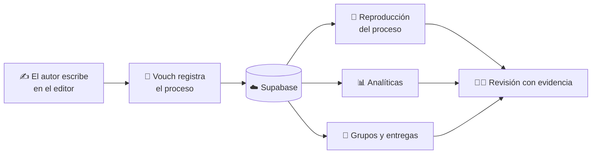

# ✍️ Vouch: editor de documentos que demuestra cómo se escribió tu trabajo

**No solo qué escribiste: cómo lo escribiste.**

Vouch es una plataforma de escritura con **trazabilidad del proceso**: registra, reproduce y analiza cómo se crea un documento, para respaldar la autoría con **evidencia** y no con suposiciones.

[🌐 Sitio web: docvouch.com](https://docvouch.com) · [🚀 Probar la demo](https://vouch-swart.vercel.app/) · [👤 Autor](https://github.com/Jona404p)

> 🔒 **Proyecto de código cerrado.** Este repositorio es solo una presentación del producto: no incluye el código fuente. Todos los derechos reservados.

---

## 📌 Índice

- [¿Qué es Vouch?](#-qué-es-vouch)
- [El problema](#-el-problema)
- [La solución](#-la-solución)
- [Funciones principales](#-funciones-principales)
- [Cómo funciona](#-cómo-funciona)
- [Para quién es](#-para-quién-es)
- [Vouch vs. un procesador de textos tradicional](#-vouch-vs-un-procesador-de-textos-tradicional)
- [Tecnologías](#-tecnologías)
- [Privacidad y confianza](#-privacidad-y-confianza)
- [Preguntas frecuentes](#-preguntas-frecuentes)
- [Estado y roadmap](#-estado-y-roadmap)
- [Licencia y contacto](#-licencia-y-contacto)

---

## 🎯 ¿Qué es Vouch?

**Vouch** es un **editor de documentos en línea** (una alternativa a un procesador de textos como Word) que **registra el proceso de creación de cada documento** y lo convierte en **evidencia verificable de autoría**.

Mientras escribes, Vouch guarda cómo evoluciona el trabajo: sesiones, ediciones, tiempos, pausas y texto pegado. Después permite **reproducir el proceso paso a paso** y consultarlo en un **panel de analíticas**.

Así, un documento deja de ser solo un resultado final y pasa a venir acompañado de **su historia**.

> 💬 *Un documento no debería representar únicamente el resultado final, sino también conservar la evidencia del proceso que llevó a su creación.*

## 🧩 El problema

Hoy es muy difícil demostrar que un texto fue escrito de forma genuina:

- Un docente solo ve el **producto final**, no el esfuerzo ni el proceso.
- Los **detectores de IA** son poco fiables y generan **falsos positivos** que perjudican a estudiantes honestos.
- Quien sí escribe su trabajo no tiene una forma sencilla de **demostrarlo**.

## 💡 La solución

En lugar de adivinar si un texto es "humano" o "generado por IA", Vouch se basa en la **evidencia del proceso**: qué se escribió, cuándo, en cuántas sesiones y de qué manera evolucionó el documento.

El autor respalda su trabajo y el revisor lo evalúa con **más contexto y menos suposiciones**.

## ✨ Funciones principales

### 📝 Editor de texto enriquecido
Un editor de documentos pensado para escribir con comodidad (formato, párrafos, listas, páginas y secciones), que integra el registro del proceso sin estorbar al autor.

### 🎙️ Registro de actividad (telemetría de escritura)
Captura lo que ocurre en el documento: escritura, texto pegado, eliminaciones, correcciones, pausas y sesiones. Construye una **línea de tiempo fiel** de la creación del archivo.

### 🕒 Sesiones de trabajo
Cada sesión queda registrada, de modo que se ve **cuánto, cuándo y cómo** se trabajó el documento.

### 🔁 Reproducción: "Ver el proceso ocurrir"
Reproduce la creación del documento paso a paso, con animaciones ajustadas a las acciones reales del autor y soporte para documentos de **varias hojas**.

### 📊 Panel de analíticas
Métricas basadas en evidencia para entender el esfuerzo detrás del texto:

- Cantidad de texto escrito y de texto pegado
- Caracteres eliminados y correcciones realizadas
- Tiempo de actividad registrado
- Eventos de edición y evolución del trabajo por sesión

### 👥 Grupos
Espacios colaborativos para organizar el trabajo:

- Crear **carpetas** y organizar entregas
- Que los integrantes **suban sus archivos Vouch** al grupo
- Configurar los **ajustes** del grupo

### 🧑‍🏫 Flujos orientados a docentes
Herramientas para revisar trabajos con el contexto del proceso, no solo con el resultado final.

### 🤖 Análisis asistido por IA
Apoyo de inteligencia artificial para interpretar documentos y su proceso de elaboración, siempre como **complemento de la evidencia** y no como veredicto único.

### 🧭 Visión del ecosistema
Vouch aspira a crecer hacia un ecosistema completo:

- **Discover:** un espacio para explorar y compartir trabajos, con una experiencia de lectura inspirada en plataformas de escritura.
- **Gestión institucional:** administración de instituciones, usuarios, roles, departamentos, grupos, periodos académicos, políticas y auditorías.

## ⚙️ Cómo funciona

1. **Escribes** en el editor de Vouch.
2. **Vouch registra** el proceso en segundo plano.
3. **Compartes** el archivo Vouch (o lo subes a un grupo).
4. **El revisor** consulta las analíticas y reproduce el proceso para entender cómo se creó el documento.

## 👤 Para quién es

| Perfil | Qué obtiene |
|---|---|
| 🎓 **Estudiantes** | Una forma de respaldar que su trabajo es propio y mostrar su esfuerzo. |
| 🧑‍🏫 **Docentes** | Contexto real del proceso para evaluar con más criterio y menos suposiciones. |
| 🏫 **Instituciones educativas** | Un entorno escalable con usuarios, grupos y políticas (en la visión del producto). |
| ✍️ **Escritores y creadores** | Un registro verificable de la autoría y evolución de sus textos. |

## 🆚 Vouch vs. un procesador de textos tradicional

| | Procesador tradicional | **Vouch** |
|---|---|---|
| Documento final | ✅ | ✅ |
| Historial del proceso de escritura | ❌ limitado | ✅ completo y reproducible |
| Analíticas de escritura, pegado y correcciones | ❌ | ✅ |
| Revisión docente con contexto del proceso | ❌ | ✅ |
| Grupos y entregas | ❌ | ✅ |
| Análisis asistido por IA | ❌ | ✅ |

## 🧱 Tecnologías

| Capa | Tecnología |
|---|---|
| Frontend | JavaScript · React |
| Backend y datos | Supabase |
| Despliegue | Vercel |
| IA | Integración de análisis asistido |

## 🔐 Privacidad y confianza

- El objetivo es **registrar el proceso, no espiar al autor**: Vouch se centra en la actividad del documento.
- La evidencia se presenta como **apoyo a la decisión humana**, no como sentencia automática.
- Las analíticas buscan ser **fieles a lo que realmente ocurrió**, evitando conclusiones infladas.
- ⚠️ **Importante:** las métricas son **indicadores de actividad**, no pruebas absolutas de autoría ni de que un documento se haya elaborado sin ayuda de IA.

## ❓ Preguntas frecuentes

**¿Qué es Vouch?**
Un editor de documentos en línea que registra el proceso de escritura y lo convierte en evidencia de autoría, con reproducción del proceso y analíticas.

**¿Vouch detecta si un texto fue escrito con IA?**
No intenta "adivinar". En lugar de un detector de IA, ofrece **evidencia del proceso** (sesiones, ediciones, pegados, tiempos) para que una persona evalúe con más contexto.

**¿Cómo puede un estudiante demostrar que escribió su propio trabajo?**
Escribiendo en Vouch y compartiendo el archivo Vouch: el revisor puede reproducir el proceso y ver las analíticas de cómo se creó el documento.

**¿Cómo puede un docente revisar el proceso de escritura de un alumno?**
Con el panel de analíticas y la reproducción paso a paso, además de los grupos para recibir y organizar entregas.

**¿Las métricas prueban la autoría?**
No de forma absoluta. Son indicadores que apoyan la decisión humana.

**¿Es de código abierto?**
No. Vouch es software propietario; este repositorio solo presenta el producto.

## 🗺️ Estado y roadmap

- [x] Editor de texto enriquecido
- [x] Registro de actividad y sesiones de trabajo
- [x] Panel de analíticas
- [x] Reproducción del proceso
- [x] Grupos
- [ ] Reproducción más fiel para documentos de varias hojas
- [ ] Rediseño UI/UX de la página de grupos
- [ ] Más funciones de verificación y reportes de evidencia
- [ ] Discover (explorar y compartir trabajos)
- [ ] Gestión institucional (roles, departamentos, periodos, políticas y auditorías)

## 📄 Licencia y contacto

**© Jonathan Paniagua. Todos los derechos reservados.**
Vouch es software propietario: el código fuente no está disponible públicamente y no se permite su copia, modificación ni distribución sin autorización expresa.

¿Quieres una demo guiada, colaborar o hablar sobre el proyecto?

  
  
  
  

---

Vouch · El proceso también cuenta

<!--
Palabras clave: vouch, editor de documentos, procesador de textos en línea, evidencia de autoría,
trazabilidad de escritura, historial de escritura, detector de IA alternativa, falsos positivos IA,
herramienta para docentes, plataforma educativa, analíticas de escritura, reproducción del proceso de escritura.
-->
